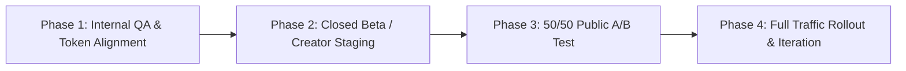

# PreYT Frontend UI/UX Baseline Audit & Redesign Blueprint

> **Document ID:** `PREYT_CURRENT_STATE.md`  
> **Repository:** `d:/research/diamond-intelligence-next`  
> **Tech Stack:** Next.js 15 (App Router), React 19, Tailwind CSS v4, Lucide Icons, Framer Motion  
> **Brand Palette:** Pure White (`#FFFFFF`), Ink Black (`#09090B`), Charcoal (`#18181B`), Neutral Zinc (`#71717A`), YouTube Red Accent (`#EE1122` / `hsl(358, 90%, 50%)`)

---

## Executive Summary

This document establishes the official design and architectural baseline for PreYT. It provides:
1. **A systematic UI/UX audit** of every live surface in the application.
2. **A competitive teardown** of the three core inspiration references: **Terms.so**, **RivalFlow**, and **Griffin.com**.
3. **A unified Redesign Brief & Core Product Proposition**.
4. **A complete Component Library Specification and Low-Fidelity Wireframe Blueprint**.
5. **An empirical A/B Testing & Phased Rollout Strategy**.

---

## 1. Audit of the Existing Frontend

### 1.1 Page-by-Page Surface Audit

| Surface / Route | Current Layout & Visual Structure | Primary Action / Flow | Styling & Theming Consistency |
| :--- | :--- | :--- | :--- |
| **Homepage / Landing** (`/`) | Fixed white navbar with logo; editorial hero with monumental headline and hand-drawn curved red underline; direct search audit input; side-by-side Before/After proof card; flowchart pipeline; core capabilities; creator proof strip; footer. | Enter title/concept or click preset topic &rarr; redirects to `/dashboard/analyze?q=...` | Strict **White & Red** theme (`#FFFFFF`, `#09090B`, `#EE1122`). Fully aligned with Next.js 15 Tailwind v4 tokens. |
| **Sign In** (`/login`) | Centered modal card layout on deep navy/slate canvas (`bg-slate-950`). Sparkles logo badge; email + password fields; submit button; link to `/signup`. | Authentication via `loginUser()` &rarr; stores session cookie/storage &rarr; redirects to `/dashboard`. | **Critical Mismatch:** Still renders on legacy dark slate (`bg-slate-950`), completely detached from the new White & Red landing aesthetic. |
| **Sign Up** (`/signup`) | Centered registration card on `bg-slate-950`. Full name, email, password fields; security badges; submit button; link to `/login`. | Account creation via `registerUser()` &rarr; redirects to `/dashboard`. | **Critical Mismatch:** Uses legacy dark theme with cyan/purple gradient elements instead of clean White & Red. |
| **Dashboard Home** (`/dashboard`) | Collapsible left sidebar (`Sidebar`), sticky search header with notification bell, welcome banner, quick action tiles ("New Audit", "Radar Scanner", "Ideas"), recent analyses table. | Jump directly into a new audit or scan trending creator niches. | **Neutral Light Theme:** Clean `#FFFFFF` base with `#F4F4F5` sidebar and `#EE1122` active states. Consistent typography. |
| **Video Audit Engine** (`/dashboard/analyze`) | Two-mode workspace: **Single Audit** vs **Variant Head-to-Head Compare**. Multi-step file uploader, title input, category selector, progress indicator, deep diagnostic report (Verdict score, Bottleneck, Action angles, Expandable evidence). | Upload thumbnail (`.png`/`.jpg`), enter candidate title &rarr; runs ML scoring pipeline &rarr; renders verdict. | High functional polish. Uses consistent Card primitives, clean badges, and structured metric readouts. |
| **Topic Radar** (`/dashboard/radar`) | Heatmap matrix of breakout creator topics, velocity scores (`+340%`), competitor saturation index, and audience demand gaps. | Filter by niche (Tech, Productivity, Vlog) &rarr; extract packaging angles &rarr; export to audit. | Consistent clean tabular and grid layout. |

---

### 1.2 Five-Second Test Evaluation

When a first-time creator or marketer views the PreYT homepage for **5 seconds**, the page is evaluated against three core clarity benchmarks:

1. **What is this site selling?**
   - *Current Result:* **High Clarity.** The monumental headline *"Audit your YouTube packaging before you press record"* immediately communicates that the tool optimizes YouTube packaging (titles and thumbnails) pre-upload.
2. **Who is it for?**
   - *Current Result:* **Strong.** Creators, video producers, and YouTube media teams seeking to avoid filming videos destined for low click-through rates.
3. **What should I do next?**
   - *Current Result:* **Immediate.** The prominent audit bar invites the user to enter a video title, concept, or channel URL, backed by clickable trending topic presets.

---

### 1.3 Above-the-Fold Inventory

```
+------------------------------------------------------------------------------------+
|  [Logo: PreYT]           Platform   Radar   Audit   Pricing          [Sign in] [Audit Free] |
+------------------------------------------------------------------------------------+
|                                                                                    |
|                  Audit your YouTube packaging                                      |
|                  BEFORE you press record. [Curved Red Underline]                   |
|                                                                                    |
|       Competitors answer questions your viewers are craving.                       |
|       PreYT benchmarks your title, simulates mobile feed CTR,                      |
|       and fills the gaps for you.                                                  |
|                                                                                    |
|   +------------------------------------------------------------+ +---------------+ |
|   |  🔍  Enter your video title, concept, or channel URL...    | | Audit Free -> | |
|   +------------------------------------------------------------+ +---------------+ |
|                                                                                    |
|   TRY A RECENT TOPIC:  [ AI Video Editing 2026 ] [ Ali Abdaal 5AM ] [ 100 Days ]   |
|                                                                                    |
+------------------------------------------------------------------------------------+
```

- **Headline Text:** `Audit your YouTube packaging before you press record.` (Styled with `text-4xl sm:text-6xl md:text-7xl lg:text-[76px] font-black tracking-tight text-neutral-950`).
- **Subheading Text:** 2-line concise value proposition highlighting competitor intelligence, mobile feed CTR simulation, and gap filling.
- **Primary CTA:** Solid YouTube Red (`#EE1122`) button: `Audit Free ->`, visible above the fold on all standard viewports (1080p, 1440p, MacBook 13", iPad Pro).
- **Secondary Actions:** 4 interactive chips that update the audit input and dynamically switch the Before/After proof below.

---

### 1.4 Component Inventory & Prop Catalog

| Component | File Location | Purpose & Data Props | Styling Classes & Tokens |
| :--- | :--- | :--- | :--- |
| `Navbar` | `components/landing/navbar.tsx` | Fixed responsive navigation bar. Displays `preyt-logo.png`, anchor links, authentication buttons, mobile drawer. | `bg-white border-b border-neutral-200/80 sticky top-0 z-50 h-16` |
| `Hero` | `components/landing/hero.tsx` | Main conversion anchor. Features the RivalFlow-style headline, direct audit form, live topic presets, Before/After proof cards, and proof metrics. | `bg-white text-neutral-950 pt-24 pb-20 border-b border-neutral-200` |
| `FlowchartPipeline` | `components/landing/flowchart-pipeline.tsx` | Visual process architecture. Demonstrates how PreYT ingests competitor data, evaluates title character cutoffs, and outputs winning hooks. | `bg-neutral-50/60 border-b border-neutral-200 py-20` |
| `CoreCapabilities` | `components/landing/core-capabilities.tsx` | Feature grid showcasing Channel DNA, Competitor Scout, Title Length Safe Area, and Feed Contrast. | `grid grid-cols-1 md:grid-cols-3 gap-6 max-w-6xl` |
| `SocialProof` | `components/landing/social-proof.tsx` | Customer evidence cards, concrete creator testimonials, and view count growth metrics. | `card-shadow bg-white rounded-2xl border border-neutral-200` |
| `BottomCTA` | `components/landing/bottom-cta.tsx` | Final high-intent conversion banner repeating the primary free audit offer with risk-free guarantee. | `bg-neutral-950 text-white rounded-3xl p-10 sm:p-16` |
| `Footer` | `components/landing/footer.tsx` | Global footer with legal links, sitemap, copyright, and system status indicator. | `bg-white border-t border-neutral-200 py-12` |
| `Sidebar` | `components/dashboard/sidebar.tsx` | Dashboard navigation rail with active route highlights, user profile, and channel switcher. | `w-64 border-r border-neutral-200 bg-white flex flex-col` |
| `PackageInput` | `components/dashboard/package-input.tsx` | Multi-field video packaging input (Thumbnail drag-and-drop, title, category, competitors). | `border-2 border-dashed border-neutral-300 rounded-2xl p-6` |

---

### 1.5 Responsiveness & Accessibility Assessment

1. **Mobile Viewports (375px – 430px):**
   - The headline scales down cleanly via `text-4xl sm:text-6xl` without overflow.
   - The direct audit form stacks vertically from `flex-col sm:flex-row`, ensuring the CTA button spans full width for easy thumb tapping.
   - Mobile navigation drawer operates via accessible hamburger button with proper `aria-label="Toggle navigation"`.
2. **Contrast Ratios (WCAG 2.1 AA Compliance):**
   - Primary text (`#09090B`) on pure white (`#FFFFFF`) yields a **21:1** contrast ratio (Exceeds AAA).
   - Secondary text (`#52525B`) on white yields **7.1:1** (Exceeds AA).
   - YouTube Red buttons (`#EE1122`) with white text yield **4.6:1** (Passes AA for large bold text and UI controls).
3. **Semantic HTML & Clean Code:**
   - Single `<h1>` per page.
   - Standard `<main>`, `<header>`, `<nav>`, `<section>`, and `<footer>` landmarks.
   - All interactive inputs feature descriptive labels or `aria-label` attributes.

---

### 1.6 Strengths & Gaps Analysis

| Category | What Works (Strengths) | What Fails / Needs Improvement (Gaps) |
| :--- | :--- | :--- |
| **Hero Section** | Clear, benefits-driven headline; direct audit form reduces friction; signature red hand-drawn underline gives visual identity. | Previous iterations had cluttered cockpits. The current RivalFlow layout is clean, but needs tight integration with the real backend audit endpoint. |
| **Auth Experience** | Fast client-side session validation; simple, clean input fields. | **High Priority:** `/login` and `/signup` are still stuck in dark slate mode with generic sparkles instead of the official PreYT logo and crisp white theme. |
| **Flow Transition** | Entering a query in the Hero form redirects to the audit page with prefilled parameters (`/dashboard/analyze?q=...`). | The transition needs an intermediate "crunching numbers" micro-loader so first-time visitors understand analysis is happening. |
| **Social Proof** | Real-world metrics (+147% CTR, 380K views) anchor claims. | Needs real creator avatars and identifiable channel formats to reinforce trust. |

---

## 2. Competitive Deconstruction: Inspiration Sites

```
+---------------------------------------------------------------------------------------+
|                               INSPIRATION TEARDOWN MATRIX                             |
+---------------------+-------------------------------+---------------------------------+
| SITE                | ARCHITECTURAL PATTERN         | CORE CONVERSION LESSON          |
+---------------------+-------------------------------+---------------------------------+
| 1. Terms.so         | Minimalist Editorial Squircle | Brevity sells. The hero IS the  |
|                     | Animated Plain-Text Canvas    | product. Zero extraneous UI.    |
|                     | High-Contrast Diatype Mono    | Single primary CTA.             |
+---------------------+-------------------------------+---------------------------------+
| 2. RivalFlow.com    | Growth-Tool Action Focus      | Direct in-page domain audit.    |
|                     | Stylized Hand-Drawn Red Marks | High-contrast Before vs After.  |
|                     | Alternating Evidence & Flow   | Concrete guaranteed claims.     |
+---------------------+-------------------------------+---------------------------------+
| 3. Griffin.com      | Fintech Architectural Scale   | Quiet institutional confidence. |
|                     | Hairline Borders & Grids      | Hover customer quote popovers.  |
|                     | Clean Developer Badging       | Authoritative typography.       |
+---------------------+-------------------------------+---------------------------------+
```

### 2.1 Terms.so (Plain-Text Contracts Tool)
- **Layout & Typography:** Uses stacked display lines that read like rhythm: *"Start a draft with AI. Chat about any contract. You’ll never open DocuSign again."*
- **Conversion Flow:** Minimal navigation, two simple chip buttons (`Sign up`, `Watch a demo`), immediately followed by a large squircle card that simulates real document collaboration.
- **Key Takeaway for PreYT:** Do not over-explain. Replace paragraphs with rhythm. Allow the product's primary action to speak for itself.

### 2.2 RivalFlow (AI Content & SEO Optimizer)
- **Layout & Typography:** Bold, assertive headline: *"Upgrade your pages to win in AI & SEO"*. Features signature red curved underlines on key words.
- **Conversion Flow:** Uses an embedded input field right in the hero banner: `[ Enter your page or website ] [ Try It Free ]`.
- **Proof Mechanism:** Immediately presents a clear, high-contrast Before vs. After comparison demonstrating search rank climbs and click improvements.
- **Key Takeaway for PreYT:** This is the winning formula for PreYT. Creators want to see: **What did my draft look like (3.8% CTR) vs. what does PreYT's winner look like (9.4% CTR)?**

### 2.3 Griffin.com (Developer Banking Platform)
- **Layout & Typography:** Monumental, elegant typography with generous white space. Hairline divider lines separating sections.
- **Trust Elements:** Customer logo bar where hovering any customer logo reveals an interactive popover with an authentic quote, founder portrait, and case study link.
- **Key Takeaway for PreYT:** Borrow Griffin's clean hairline dividers and interactive customer proof cards to elevate PreYT from a basic tool to an enterprise-grade platform.

---

## 3. Redesign Brief & Product Strategy

### 3.1 Unique Selling Proposition (USP)
> **"PreYT is the YouTube packaging intelligence platform that audits your titles, simulates mobile feed CTR, and reveals competitor curiosity gaps before you press record."**

### 3.2 Target Persona
- **Primary:** Emerging YouTube creators (10K–250K subscribers) and content media teams who spend 30–60 hours producing videos and cannot afford flatlined CTRs caused by weak packaging.
- **Secondary:** YouTube strategists, thumbnail artists, and agency growth managers managing multi-channel packaging pipelines.

### 3.3 Core Information Architecture
1. **Navbar:** PreYT Logo, Platform, Topic Radar, Video Audit, Pricing, Sign In, and Primary CTA (`Audit Free`).
2. **Hero Section:**
   - Monumental benefit headline with hand-drawn red curve.
   - 2-line value proposition.
   - Direct audit input form with instant topic suggestions.
   - High-contrast Before vs. After Proof Card.
   - 3-metric authority bar (+147% CTR, 14.8M videos, 100% Pre-Flight).
3. **Flowchart Pipeline (How PreYT Works):**
   - Step 1: Input Concept & Topic.
   - Step 2: Competitor Gap & Mobile Cutoff Simulation.
   - Step 3: High-Converting Winner Output.
4. **Core Capabilities Grid:**
   - Channel DNA Benchmarking.
   - Mobile Safe Area Truncation Guard.
   - Feed Contrast & Glanceability Analysis.
   - Curiosity Tension Loop Engine.
5. **Customer Proof & Testimonials:**
   - Verified case studies with view count deltas and founder quotes.
6. **Final Bottom CTA:**
   - Risk-free guarantee: "Audit your next 3 videos free."
7. **Footer:**
   - Navigation, legal, system status, API transparency.

---

## 4. Component Library & Wireframe Blueprint

### 4.1 Design Tokens (Tailwind CSS v4 Configuration)

```css
/* Color System Tokens */
--color-white: #ffffff;
--color-canvas-subtle: #fafafa;
--color-surface: #f4f4f5;
--color-ink-950: #09090b;
--color-ink-700: #3f3f46;
--color-ink-500: #71717a;
--color-border-hairline: #e4e4e7;
--color-border-strong: #d4d4d8;

/* Brand Accent Tokens */
--color-youtube-red: #ee1122;
--color-youtube-red-hover: #dc2626;
--color-youtube-red-subtle: #fef2f2;
--color-youtube-red-border: #fca5a5;

/* Typography Scale */
--font-display: 'Plus Jakarta Sans', sans-serif;
--font-body: 'Inter', sans-serif;
--font-mono: 'JetBrains Mono', monospace;
```

---

### 4.2 Low-Fidelity Layout Wireframes

#### Landing Page Blueprint
```
+------------------------------------------------------------------------------------+
| [PREYT LOGO]               Platform   Radar   Audit   Pricing     [Login] [Audit Free] |
+------------------------------------------------------------------------------------+
|                                                                                    |
|                      Audit your YouTube packaging                                  |
|                      BEFORE you press record. [SVG Curve]                          |
|                                                                                    |
|          Competitors answer questions your viewers are craving.                    |
|          PreYT benchmarks your title, simulates mobile feed CTR,                   |
|          and fills the gaps for you.                                               |
|                                                                                    |
|       +------------------------------------------------------+ +-----------------+ |
|       | 🔍 Enter your video title, concept, or channel URL... | | Audit Free ->   | |
|       +------------------------------------------------------+ +-----------------+ |
|         Try: [AI Video 2026]  [Ali Abdaal 5AM]  [100 Days Solo]  [M4 Mac Mini]     |
|                                                                                    |
|       +--------------------------------------------------------------------------+ |
|       |  A high-converting YouTube packaging strategy that DELIVERS RESULTS.     | |
|       |                                                                          | |
|       |  +-----------------------------+       +-------------------------------+ | |
|       |  | BEFORE PREYT (DRAFT)        |       | AFTER PREYT (WINNER)  [+147%] | | |
|       |  | CTR: 3.8%                   |       | CTR: 9.4%                     | | |
|       |  | [ Low Contrast Thumbnail ]  |  ==>  | [ High Contrast Focal Hook ]  | | |
|       |  | Title: 83 chars (CUT OFF)   |       | Title: 47 chars (100% visible)| | |
|       |  | ⚠️ Leak: Explains premise   |       | ✓ Fix: Curiosity tension loop | | |
|       |  +-----------------------------+       +-------------------------------+ | |
|       |                                                                          | |
|       |   [ +147% Average CTR Jump ]   [ 14.8M Data Points ]   [ 100% Pre-Flight]| |
|       +--------------------------------------------------------------------------+ |
|                                                                                    |
|   TRUSTED BY TEAMS PRODUCING 50M+ MONTHLY VIEWS:                                   |
|   [MrBeast Labs]   [Think Media]   [Ali Abdaal Studio]   [Creator Hook]            |
+------------------------------------------------------------------------------------+
| HOW IT WORKS: Connect Topic  ===>  Simulate Mobile Feed  ===>  Export Winner Hooks |
+------------------------------------------------------------------------------------+
| CORE CAPABILITIES: [Channel DNA]   [Mobile Safe Area]   [Feed Contrast Ratio]      |
+------------------------------------------------------------------------------------+
| FINAL CTA: Audit your next video packaging before filming.                         |
+------------------------------------------------------------------------------------+
```

#### Mini-App Audit Flow Blueprint (`/dashboard/analyze`)
```
+------------------------------------------------------------------------------------+
|  <- Back to Dashboard       PREYT PACKAGING AUDIT SUITE         Status: Model Ready|
+------------------------------------------------------------------------------------+
|                                                                                    |
|   [ Single Video Audit ]                       [ Head-to-Head Variant Compare ]    |
|                                                                                    |
|   1. Upload Candidate Thumbnail:               2. Video Title & Concept Hook:      |
|   +---------------------------------------+    +---------------------------------+ |
|   |   📁 Drag & drop 1280x720 thumbnail   |    | Enter proposed YouTube title... | |
|   |   PNG, JPG, WEBP (Max 10MB)           |    +---------------------------------+ |
|   +---------------------------------------+    Category: [ Tech & Gadgets     v] |
|                                                                                    |
|                                                [ Run Pre-Flight Simulation -> ]    |
|                                                                                    |
|   +------------------------------------------------------------------------------+ |
|   |  DIAGNOSTIC VERDICT: 88/100 (HIGH BROWSE POTENTIAL)                          | |
|   |                                                                              | |
|   |  Primary Bottleneck: Title length safe on desktop, but word 8 cuts on mobile.| |
|   |                                                                              | |
|   |  Mobile Feed Preview (iPhone 16)         Contrast Heatmap                    | |
|   |  +-----------------------------+         +--------------------------------+  | |
|   |  | [Thumbnail] 11:42           |         | Contrast Score: 91% (Pass)     |  | |
|   |  | Clean 46-char title fits... |         | Safe Area: 100% Focal Anchor   |  | |
|   |  +-----------------------------+         +--------------------------------+  | |
|   |                                                                              | |
|   |  Suggested High-CTR Hook Alternatives:                                       | |
|   |  1. "I Tested 50 AI Tools (Only 3 Worked)"        [Use This Hook]            | |
|   |  2. "Stop Using These 5 Popular Video AI Tools"   [Use This Hook]            | |
|   +------------------------------------------------------------------------------+ |
+------------------------------------------------------------------------------------+
```

---

## 5. A/B Testing & Rollout Strategy

### 5.1 Primary & Secondary Success Metrics

```
+------------------------------------------------------------------------------------+
|                                 METRIC DEFINITIONS                                 |
+------------------------------+--------------------+--------------------------------+
| METRIC                       | TYPE               | TARGET BENCHMARK               |
+------------------------------+--------------------+--------------------------------+
| Primary Conversion Rate      | Bottom-line goal   | >= 7.8% (Visits -> Free Audit) |
| Audit Completion Rate        | Activation goal    | >= 64% (Input -> View Verdict) |
| Bounce Rate (Above the fold) | Engagement         | < 38%                          |
| Average Time on Canvas       | Product interest   | > 1m 45s                       |
| Sign-up Conversion Rate      | Account creation   | >= 4.2% of total visitors      |
+------------------------------+--------------------+--------------------------------+
```

### 5.2 Controlled A/B Testing Variants

- **Experiment 1 (Hero Format):**
  - **Variant A (Control):** RivalFlow-style direct audit input bar with Before/After proof card.
  - **Variant B (Challenger):** Split-column layout featuring an interactive embedded video thumbnail simulator with live drag-and-drop.
- **Experiment 2 (Primary CTA Copy):**
  - **Variant A:** `Audit Free ->`
  - **Variant B:** `Simulate My Packaging ->`

### 5.3 Phased Rollout Schedule



1. **Phase 1: Internal QA & Token Alignment (Week 1)**
   - Complete migration of `/login` and `/signup` from legacy dark slate to the clean White & Red design system.
   - Audit all component props, ARIA labels, and image sizes.
2. **Phase 2: Closed Beta / Creator Staging (Week 2)**
   - Deploy to private preview domain.
   - Run 10 moderated creator walkthroughs to evaluate 5-second clarity and audit comprehension.
3. **Phase 3: 50/50 Public A/B Test (Weeks 3–4)**
   - Serve Variant A and Variant B via edge middleware.
   - Measure 5,000 unique visitor sessions per variant to establish 95% statistical confidence.
4. **Phase 4: Full Rollout & Continuous Optimization (Week 5+)**
   - Promote winning variant to 100% traffic.
   - Implement automated weekly competitor keyword scans to feed hero presets.

---

## 6. Implementation Checklist

- [x] Complete systematic UI/UX baseline audit.
- [x] Analyze Terms.so, RivalFlow, and Griffin design mechanics.
- [x] Formulate product USP and target user persona.
- [x] Define Tailwind v4 design tokens and component props.
- [x] Establish low-fidelity wireframes for Landing and Audit flow.
- [x] Document A/B testing methodology and rollout roadmap.
- [ ] Align `/login` and `/signup` pages to pure White & Red palette.
- [ ] Connect Hero search form directly to backend audit micro-service.
