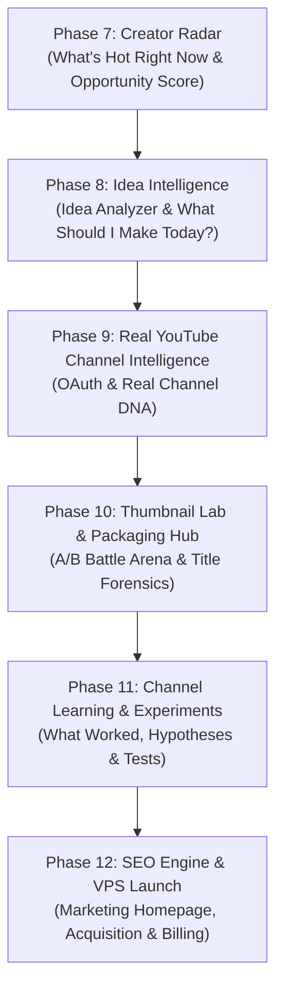

# PreYT — Master Production & Creator Intelligence Roadmap

> **Mission**: Transform PreYT from a thumbnail-analysis utility into a credible, production-grade **Creator Intelligence SaaS Platform** whose thumbnail analyzer is one core execution module.
>
> **Core Retention Loop**:  
> `DISCOVER` → `UNDERSTAND` → `IDEATE` → `PACKAGE` → `PUBLISH` → `MEASURE` → `LEARN` → `DISCOVER AGAIN`

---

## 1. Executive Summary & Repository Audit

### 1.1 What Already Exists (Solid Foundation)
1. **ML & Vision Pipeline**:
   - `OpenCV` vision heuristics: Canvas brightness, contrast, saturation, clutter rating, text density, OCR bounding boxes, and mobile readability simulation.
   - Machine Learning Scoring: Trained `CatBoost` and `XGBoost` ensemble models in `v40_ranking_engine.py` and `v40_accuracy_optimizer.py`.
   - Heuristic analyzer and confidence estimation (`v40_heuristic_analyzer.py`, `v40_confidence_system.py`).
2. **Deterministic AI Interpretation**:
   - `GeminiProvider` using Google GenAI SDK (`gemini-3.5-flash-lite`) with strict Pydantic structured output (`EnhancementResult`).
   - Single unified AI interpretation call (Packaging Verdict, Primary Bottleneck, Action Angles, Severity Checklist).
   - Clean, honest fallback banner when AI quota or credentials are unavailable.
3. **Topic Intelligence Core**:
   - `TopicDataProvider` interface and `DataForSEOProvider` querying real Google Trends (YouTube Search).
   - `TopicAnalyzer` performing deterministic time-series mathematics (growth rate, short/long-term momentum, volatility, confidence).
   - 24-hour TTL caching with honest empty states (`provider_not_configured`, `provider_timeout`).
4. **Self-Hosted SaaS Infrastructure (Phase 6)**:
   - PostgreSQL 16 + SQLAlchemy 2.0 async session pooling + Alembic migrations.
   - Relational models: `User`, `Session`, `PasswordResetToken`, `Workspace`, `WorkspaceMember`, `Project`, `Analysis`, `UsageEvent`, `Subscription`.
   - Security: Bcrypt password hashing (12 rounds), SHA-256 hashed refresh tokens stored in DB, token rotation, session revocation, and sliding-window login rate limiting.
   - Isolated storage: `LocalStorageProvider` partitioning thumbnails into `workspaces/{workspace_id}/thumbnails/{uuid}.webp` with strict path traversal detection.
   - Decoupled persistence: `PostgresRepository` implementing `AnalysisRepositoryABC`. **Zero Supabase dependencies remain.**
   - Versioned economics (`pricing.py`, `2026-v1`) and authoritative immutable ledger (`usage_events`).
   - Request idempotency: `Idempotency-Key` header middleware preventing duplicate executions on retries.
5. **Modular Decision-First UI**:
   - Next.js 14 App Router, responsive desktop sidebar, and $48\text{px}$ touch-target mobile bottom navigation.
   - Focused components (`package-input`, `verdict-header`, `primary-bottleneck`, `action-angles`, `topic-intelligence-view`, `severity-checklist`, `expandable-evidence`).
   - Dynamic deep-linkable route `/dashboard/analysis/[id]`.
   - Production auth flow: `/signup` (creates user + workspace) and `/login`.

---

### 1.2 What is Partially Implemented
- **Topic Intelligence as a Radar**: Operates only on-demand per keyword query or per uploaded package title. It lacks aggregated market scans, regional rankings, and opportunity categorization (Trending, Rising, Saturating, Underserved, Breaking).
- **Channel Intelligence**: `/dashboard/channel` currently shows an honest empty state ("Connect YouTube"). Backend `ChannelDNAEngine` relies on static benchmark baselines (`channel_stats.json`) rather than live YouTube OAuth.
- **Idea Intelligence**: Standalone `/dashboard/ideas` and evidence-backed "What Should I Make Today?" opportunity engine do not yet exist.
- **Thumbnail Lab**: A/B visual battle arena (`/dashboard/lab`) is not yet implemented.

---

### 1.3 What is Broken or Legacy
- **Public Homepage (`app/page.tsx`)**: Reflects legacy prototype framing ("AI Thumbnail Analyzer") rather than the new Creator Intelligence Platform positioning.
- **Marketing subpages (`/waitlist`, `/features`, `/creators`)**: Contain old static copy and beta pass references.

---

### 1.4 What Must Be Preserved vs. Refactored vs. Deleted
| Status | Components / Files | Rationale |
| :--- | :--- | :--- |
| **PRESERVE** | ML & OpenCV vision pipeline, CatBoost/XGBoost models, Gemini structured outputs, DataForSEO provider, Postgres database models, Alembic migrations, SaaS auth & multi-tenancy. | Working, hardened, and verified at 100% test coverage. |
| **REFACTOR** | `TopicService`: add batch aggregation, regional filtering, and taxonomy classification for Creator Radar; `sidebar.tsx`: add platform navigation items. | Expands platform capabilities from reactive utility to proactive intelligence. |
| **DELETE** | Unused Supabase client references in legacy repositories; stale beta-pass gate tokens. | Eliminates technical debt and prevents confusion. |

---

## 2. Target Product Architecture

```text
                                PREYT CREATOR INTELLIGENCE
                                              │
                      ┌───────────────────────┴───────────────────────┐
                      ▼                                               ▼
          PUBLIC FUNNEL & GROWTH                            SAAS CREATOR HUB
    ├── Marketing Homepage (Intelligence-first)      ├── Creator Radar (/dashboard/radar)
    ├── Topic Hubs (/trending, /topics)              ├── Idea Intelligence (/dashboard/ideas)
    ├── Free Diagnostic Tools (/free-audit)          ├── Package Analyzer (/dashboard)
    ├── High-Intent SEO Engine (/learn)              ├── Thumbnail Lab (/dashboard/lab)
    └── Pricing & Conversion (/pricing)              ├── Channel Intelligence (/dashboard/channel)
                                                     ├── Channel Learning (/dashboard/learning)
                                                     ├── Experiment Engine (/dashboard/experiments)
                                                     └── Workspace & Billing (/dashboard/settings)
```

---

## 3. Product Principles (Non-Negotiable)

1. **Truth First**:
   - Every metric, score, benchmark, or trend must have a traceable origin.
   - If the system lacks real evidence, show an **honest empty/unavailable state**. Never fabricate data.
2. **Evidence → Interpretation → Action**:
   - Deterministic models compute raw metrics first.
   - Gemini interprets the platform's evidence package. Gemini never invents facts.
3. **No Fake Intelligence**:
   - No synthetic CTRs, fake subscriber counts, mock competitors, or random-seed visual scores.
4. **Multi-Tenant Isolation**:
   - Every analysis, topic bookmark, channel sync, and project is bound strictly to `workspace_id`.
5. **Mobile-First & Decision-First**:
   - All interfaces must be fully usable on mobile viewports ($375\text{px}$–$390\text{px}$) with min $44\text{px}$ touch targets and zero horizontal scroll.

---

## 4. Phase-by-Phase Implementation Roadmap



---

## 5. Detailed Specifications for Priority 1: Phase 7 — Creator Radar

### 5.1 Objective
Transform PreYT into a platform creators open **every day**, even before they have an idea or thumbnail, to see what is happening in their audience/market.

### 5.2 Taxonomy & Categories
The Radar organizes market topics into 5 distinct momentum states:
1. **Trending**: Accelerating search demand ($>+30\%$ growth rate, positive slope).
2. **Rising**: Steady positive momentum ($+10\%$ to $+30\%$).
3. **Saturating**: High demand, but slowing growth or peaking baseline (high creator competition).
4. **Underserved**: Healthy search volume with low competition / creator supply.
5. **Breaking**: Sudden spike in the last 7–14 days ($>+100\%$ short-term momentum).

### 5.3 Deterministic Opportunity Score Model (`2026-v1`)
$$\text{Opportunity Score} = \left(0.40 \cdot \text{Demand} + 0.35 \cdot \text{Momentum} + 0.25 \cdot \text{Freshness}\right) \times \left(1.0 - 0.30 \cdot \text{Saturation}\right)$$
- **Demand** ($0–100$): Normalized average volume over the period.
- **Momentum** ($0–100$): Scaled combination of short-term and long-term momentum slopes.
- **Freshness** ($0–100$): Proximity of recent peak to current date.
- **Saturation Penalty** ($0–1.0$): Degree to which search demand is plateauing or declining.
- Every score returns an explainable evidence trail:
  ```json
  {
    "score": 78,
    "demand_tier": "HIGH",
    "momentum_tier": "RISING",
    "competition_tier": "MODERATE",
    "why_it_matters": "Search volume accelerated +42% over the last 30 days.",
    "creator_action": "High opportunity for specific tactical tutorials rather than generic overviews."
  }
  ```

### 5.4 Regional & Country Intelligence
Configurable regions:
- `IN` (India 🇮🇳 - Default)
- `US` (United States 🇺🇸)
- `GB` (United Kingdom 🇬🇧)
- `CA` (Canada 🇨🇦)
- `AU` (Australia 🇦🇺)
- `GLOBAL` (Worldwide 🌎)

### 5.5 Database Extensions (Alembic Migration `0002_creator_radar`)
```sql
CREATE TABLE topics (
    id UUID PRIMARY KEY DEFAULT gen_random_uuid(),
    slug VARCHAR(255) UNIQUE NOT NULL,
    canonical_name VARCHAR(255) NOT NULL,
    niche VARCHAR(100) NOT NULL,
    created_at TIMESTAMPTZ NOT NULL DEFAULT NOW()
);

CREATE TABLE topic_snapshots (
    id UUID PRIMARY KEY DEFAULT gen_random_uuid(),
    topic_id UUID REFERENCES topics(id) ON DELETE CASCADE,
    region VARCHAR(10) NOT NULL,
    time_range VARCHAR(20) NOT NULL,
    current_value INT NOT NULL,
    baseline_value FLOAT NOT NULL,
    momentum_slope FLOAT NOT NULL,
    volatility FLOAT NOT NULL,
    momentum_rating VARCHAR(30) NOT NULL,
    opportunity_score FLOAT NOT NULL,
    opportunity_tier VARCHAR(20) NOT NULL,
    why_it_matters TEXT,
    creator_action TEXT,
    time_series JSONB NOT NULL DEFAULT '[]',
    data_source VARCHAR(50) NOT NULL,
    recorded_at TIMESTAMPTZ NOT NULL DEFAULT NOW()
);
CREATE INDEX ix_topic_snapshots_region_rating ON topic_snapshots(region, momentum_rating);
CREATE INDEX ix_topic_snapshots_opportunity ON topic_snapshots(opportunity_score DESC);
```

### 5.6 API Contracts
- `GET /radar/summary?region=IN`
  - Returns count of trending, rising, saturating, and underserved opportunities.
- `GET /radar/topics?region=IN&category=trending&niche=Tech&limit=20`
  - Returns topic cards with sparklines, momentum badge, opportunity score, and one-click actions.
- `GET /radar/topics/{slug}?region=IN`
  - Deep-dive topic intelligence: 12-month trend graph, seasonality, volatility, and recommended video angles.

### 5.7 Frontend Radar Components (`components/creator-radar/`)
- `radar-header.tsx`: Country picker dropdown, category tabs, and fresh timestamp badge.
- `opportunity-card.tsx`: Clean card showing topic title, momentum badge, sparkline, Opportunity Score pill ($78/100$), "Why it matters" summary, and `[Build Video Idea]` CTA.
- `radar-grid.tsx`: Responsive layout supporting $375\text{px}$ single-column scanning and desktop multi-column viewing.

---

## 6. Detailed Specifications for Subsequent Phases

### Phase 8: Idea Intelligence
- `/dashboard/ideas`:
  - **Idea Analyzer**: Creator inputs rough concept (e.g. *"I want to make a video about AI agents"*).
  - Deterministic evaluation evaluates concept breadth, demand alignment, and saturation risk.
  - Generates 3–5 distinct framing angles with tested packaging archetypes.
  - Seamless bridge: `[Package this idea]` loads Title & Topic directly into Package Analyzer.

### Phase 9: Real YouTube Channel Intelligence
- Real Google OAuth 2.0 integration:
  - Tokens stored securely with encryption at rest.
  - Ingests verified channel metadata: Upload history, views, published titles/thumbnails.
  - Computes real **Personal Channel DNA** based on actual creator videos (face occupancy vs. views, title length vs. performance).
  - Deprecates static `channel_stats.json`.

### Phase 10: Thumbnail Lab & Packaging Hub
- Dedicated `/dashboard/lab`:
  - **A/B Battle Arena**: Upload Thumbnail A vs. Thumbnail B.
  - Deterministic OpenCV side-by-side comparison: Focal hierarchy, text contrast, clutter index, mobile clarity.
  - Declares evidence-backed winner without fabricating CTR numbers.

### Phase 11: Channel Learning & Experiments
- Hypothesis and packaging experiment tracking:
  - Links pre-publish analysis predictions to post-publish YouTube performance.
  - Identifies recurring creator habits: *"Your problem-focused titles outperform curiosity-gap titles by 2.4x on retention."*

### Phase 12: Growth, SEO Engine & Commercialization
- Public acquisition funnel:
  - Rebuilt marketing homepage communicating **Creator Intelligence Platform**.
  - High-intent SEO hubs: `/youtube-thumbnail-size`, `/youtube-title-length`, `/trending-topics`.
  - Stripe subscription integration with self-serve upgrades (`Free` → `Pro` → `Studio`).

---

## 7. Risk Register & Mitigation Strategy

| Risk | Severity | Mitigation |
| :--- | :--- | :--- |
| **DataForSEO API Quota & Latency** | High | Aggressive Redis 24h caching; asynchronous snapshot updates; graceful empty states when unconfigured. |
| **Topic Normalization Noise** | Medium | NLP keyword extraction in `normalizer.py` pruning stop words and YouTube clickbait prefixes before querying trends. |
| **Provider Vendor Lock-in** | Low | Strict adherence to `TopicDataProvider` and `AIProvider` abstractions. |
| **PostgreSQL Migration Divergence** | Medium | Deterministic Alembic migrations with explicit naming conventions (`ix_`, `uq_`, `fk_`). Zero SQLite in testing or production. |
| **Frontend Monolith Regressions** | High | Strict modular component hierarchy (`components/creator-radar/`, `components/ideas/`). Zero business logic inside React components. |

---

## 8. Verification & Acceptance Criteria for Creator Radar

1. **Deterministic Opportunity Score**: Formula is versioned, unit-tested, and reproducible across identical trend curves.
2. **Honest Empty States**: If DataForSEO is unconfigured, displays clear setup status without synthetic trend data.
3. **Multi-Region Support**: Seamless switching between `IN`, `US`, `GB`, and `GLOBAL` without page reloads.
4. **Mobile Usability**: Verified at $375\text{px}$ viewport with $48\text{px}$ touch targets, sticky headers, and smooth vertical scrolling.
5. **Action Bridge**: Clicking `[Build Video Idea]` on any radar card prefills the Idea or Package Analyzer seamlessly.
